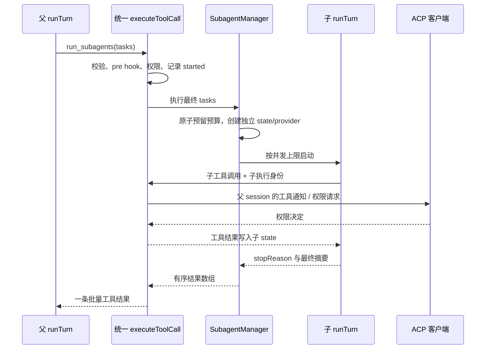

# Sangxia Subagent 模式实现设计

状态：设计提案，尚未实现。日期：2026-10-14。

## 1. 目标与推荐方案

Subagent 用于把边界明确的调查、审查或实现任务交给独立上下文的子代理。父代理负责拆分任务、提供必要背景、检查结果并向用户交付；子代理在指定工具和预算内执行，最终返回摘要与证据。

推荐采用 **父 ACP session 内的进程内子代理 + 阻塞式批量委派工具**：

- 新增模型工具 `run_subagents`，一次提交一个或多个任务，等待本批次全部结束后返回结果。
- 子代理复用现有 `runTurn` 和统一工具执行流程，独立拥有 messages、provider、调用 ID、预算与 AbortController。
- ACP 客户端始终只看见父 session；子代理不是新的 ACP session，也不启动另一套 stdio agent。
- 首先交付只读 `explorer`，再支持同一批次的只读并行；可写 `worker` 单独作为后续阶段交付。
- 第一版仅允许一层子代理，不支持后台运行、子代理互发消息、递归派生或继续旧子代理。接口保留任务 ID，便于后续扩展。

这是工具层的委派能力，不新增 ACP `session/set_mode` 模式。现有 `confirm` / `auto` 仍然表示权限模式，两者含义保持清楚。

### 为什么选择阻塞式批量工具

当前父 harness 按顺序执行模型返回的 tool calls。连续调用多个 `spawn` 并不会自然获得并行，后台任务还会带来跨 turn 存活、通知插入、恢复和队列管理问题。批量工具在一次执行中调度多个子代理，父循环无需改变工具调用顺序，仍能取得只读任务并行的收益。

先做单任务闭环，再提高配置中的并发数；不需要先实现多代理聊天系统。

## 2. 已有基础与需要修改的耦合

下表是本设计所依据的现有代码。表中“需要调整”均为未来实现工作。

| 现有模块 | 当前行为 | 需要调整 |
| --- | --- | --- |
| [loop.ts](air-file://vp9c4nkm0sjid9eha9rh/workspaces/sangxia-ai/src/harness/loop.ts?type=file&root=%252F) | `runTurn` 直接操作 Session、持久化、发送 ACP 通知；`executeToolCall` 为模块私有函数 | 分离运行状态、输出与持久化接口；保留唯一工具执行实现 |
| [tool.ts](air-file://vp9c4nkm0sjid9eha9rh/workspaces/sangxia-ai/src/harness/tool.ts?type=file&root=%252F) | `ToolContext` 含 `conn`、`session`、`signal` | 内置工具继续取得父 session，附加可选执行身份；子对话状态不交给工具 |
| [session.ts](air-file://vp9c4nkm0sjid9eha9rh/workspaces/sangxia-ai/src/session.ts?type=file&root=%252F) | 含 messages、权限记忆、abort、工具、MCP 连接与技能 | 父会话拥有 SubagentManager；子状态独立，不加入 ACP sessions 集合 |
| [permissions.ts](air-file://vp9c4nkm0sjid9eha9rh/workspaces/sangxia-ai/src/harness/permissions.ts?type=file&root=%252F) | 以 session.id 请求权限，按工具名记忆决策 | 继续使用父会话；增加可取消的权限请求队列 |
| [types.ts](air-file://vp9c4nkm0sjid9eha9rh/workspaces/sangxia-ai/src/llm/types.ts?type=file&root=%252F) | Provider 暴露 `lastUsage` / `lastPromptTokens` | 每个子代理创建独立 provider，避免并行 usage 串扰 |
| [persistence.ts](air-file://vp9c4nkm0sjid9eha9rh/workspaces/sangxia-ai/src/persistence.ts?type=file&root=%252F) | append-only JSONL；`tool_started` 用于中断修复 | 新增有子代理作用域的事件与串行写队列；不能污染父 history |
| [model.ts](air-file://vp9c4nkm0sjid9eha9rh/workspaces/sangxia-ai/src/tui/model.ts?type=file&root=%252F) | 文本 delta 聚合成同一 assistant 流，工具按 ID 更新 | 子文本转换成工具进度；不能进入父 assistant 文本流 |

当前未发现 subagent 实现。[AGENTS.md](air-file://vp9c4nkm0sjid9eha9rh/workspaces/sangxia-ai/AGENTS.md?type=file&root=%252F) 中的 D6 预留约定要求：子代理的每步工具调用走统一 `executeToolCall`，继承工具 hooks，但不产生独立会话生命周期事件。

调研时，AGENTS 中引用的 Hook 详细计划和项目记忆均未出现在工作树中。本设计以实际代码与 AGENTS 中明确写出的不变式为依据；实施时若补回详细计划，需要复核约定。本次另按项目规则建立记忆并登记设计状态。

## 3. 模型工具与结果协议

### 3.1 `run_subagents` 输入

工具 `kind` 使用 `other`。配置开启且调用者为父代理时才注册，子代理工具集中永远不包含它。

```ts
interface RunSubagentsInput {
  tasks: Array<{
    taskId: string;               // 当前批次唯一，1–64 个 ASCII 字母/数字/连字符
    role: "explorer" | "worker";
    title: string;                // 短标题，用于工具行及权限弹窗
    prompt: string;               // 任务、边界、验收条件和期望返回格式
    context?: string;             // 父代理选择的背景，不自动复制整个历史
  }>;
}
```

JSON Schema 设置 `additionalProperties: false`，包括每个 task；限制 tasks 数量、标题、prompt 和 context 长度。任务 ID 不作为文件路径。服务端生成 UUID 格式的 `batchId`、`subagentId`，在日志和通知中使用这些 ID。

运行时再验证：taskId 唯一、role 已开启、预算允许、第一版仅 explorer。后续 worker 批次必须恰好一个任务，拒绝 worker 与 explorer 混合批次。所有检查都在启动任何子任务前完成。

输入不暴露 cwd、permissionMode、provider 配置、任意 system prompt、递归深度或工具白名单。它们由父会话和本地配置确定，模型不能自行放宽。

调用示例（只读并行阶段）：

```json
{
  "tasks": [
    {
      "taskId": "permissions",
      "role": "explorer",
      "title": "检查权限流程",
      "prompt": "调查工具权限与 hook ask 的执行顺序，返回具体函数、证据和风险；不要修改文件。"
    },
    {
      "taskId": "persistence",
      "role": "explorer",
      "title": "检查会话恢复",
      "prompt": "调查 JSONL 中断恢复如何区分已启动与未启动工具，返回具体函数和需要覆盖的回归场景。"
    }
  ]
}
```

### 3.2 返回值

```ts
type SubagentStatus =
  | "completed" | "failed" | "cancelled"
  | "timed_out" | "budget_exceeded" | "interrupted";

interface SubagentResult {
  taskId: string;
  subagentId: string;
  role: "explorer" | "worker";
  status: SubagentStatus;
  stopReason?: string;            // 原 harness StopReason，保留诊断信息
  summary: string;                // 子代理最终文本，不包含 reasoning
  truncated: boolean;
  elapsedMs: number;
  iterations: number;
  toolCalls: number;
  effects: "none" | "possible";   // 依据已分派的工具记录，而非模型自述
  error?: { code: string; message: string };
}

interface RunSubagentsOutput {
  batchId: string;
  results: SubagentResult[];       // 始终按输入任务顺序排列
}
```

结构化结果由 runtime 组装，不要求模型输出严格 JSON。任务 prompt 要求模型在最终文本中给出“结论、证据、修改与验证、未完成事项”；worker 的模型报告不能替代实际工具记录。

`ToolResult.output` 是有大小限制的结果 JSON，供父模型阅读；`raw` 同步承载同一结果供客户端显示。至少一个子任务未 completed 时，外层 `isError: true`，同时保留已成功任务的结果。单个失败不主动取消同批其他任务。

只有 harness 正常 `end_turn` 且有有效最终文本时才标记 completed；迭代耗尽、截断、拒绝或异常不得包装成成功。缺少最终文本时允许返回最后的可见文本作为 partial summary，但 status 必须标明失败原因。

父代理收到摘要后负责核对证据、检查修改并继续任务。摘要作为 tool result 回填，不能提升为 system 指令。

## 4. 运行模型与 harness 重构

### 4.1 运行状态与父会话分离

以下接口是建议形态，不是当前已经存在的 API：

```ts
interface RunState {
  runId: string;
  messages: ChatMessage[];
  startedToolCalls: Set<string>;
  historyWarned: boolean;
  turnIterations: number;
}

interface ExecutionIdentity {
  parentSessionId: string;
  batchId?: string;
  subagentId?: string;
  parentToolCallId?: string;
  role: "parent" | "explorer" | "worker";
  depth: 0 | 1;
}

interface RunIO {
  emit(event: HarnessEvent): Promise<void>;
  persistMessages(state: RunState): Promise<void>;
  persistReset(state: RunState): Promise<void>;
  persistToolEvent(event: ScopedToolEvent): Promise<void>;
}
```

`RunTurnOptions` 改为接受 `state`、`parentSession`、`identity`、`io`、预算及现有 provider/tools/config/signal/hooks。`HarnessEvent` / `ScopedToolEvent` 是需要新增的内部类型，先覆盖当前循环已经产生的事件，不构建通用消息总线。

关键职责：

- **state**：当前对话历史、tool result 配对、迭代计数，只属于本 run。
- **parentSession**：ACP ID、cwd、clientCaps、权限记忆、技能目录和 MCP 连接所有权。
- **io**：决定消息落到父 history 还是子 transcript，决定 delta 的展示方式。
- **统一 executor**：schema → pre hook → 最终参数校验 → 能力检查 → 通知 → 权限 → started 事件 → deadline race → tool.run → post hook → 当前 state 的 tool result。

父运行用 adapter 保持原有行为；子运行用 child adapter。不通过复制 Session 或伪造 AgentSideConnection 改写 sessionId 来隔离子代理。

工具仍收到真实父 session：文件读写和客户端终端接口已经依赖 `ctx.session.id` / clientCaps。附加可选 identity 用于诊断即可；子消息写入 executor 的 RunState，不能通过 ToolContext 修改父 messages。

内置 `update_plan` 会发送父会话 plan 通知，第一版对子代理禁用。循环接近预算的收尾提示也要按角色生成，不能要求子代理调用一个未暴露的 `update_plan`。

### 4.2 子代理生命周期



状态流转：`queued → running → terminal`。未开始的 queued 任务取消后直接进入 cancelled；每个任务和批次只有一个终态。终态通过幂等 finalize 写入，迟到 delta / promise 结果不得再次结束任务或改写父结果。

子代理拥有私有 AbortController，父 signal 和外层工具 deadline 都向下传播。不得覆盖父 `session.abort`，不得调用 ACP `newSession` / `prompt` 来运行子代理。

SubagentManager 在父 prompt finally 与 Session.dispose 中执行有界清理：abort 未结束任务、取消队列、回收监听器和 timer、隔离迟到回调。MCP 连接归父会话所有，子代理不得 close 共享连接。

## 5. 上下文、角色与模型

### 5.1 子上下文组成

子代理起始历史只有新的 system message 和新的 task user message：

1. 从父会话建立时保存的基础上下文快照生成 system：用户/项目规则、项目记忆、配置 systemPrompt、session_start 注入内容和技能目录。
2. 追加 role 说明、工具限制、无递归约定、预算与结果格式。
3. user message 放入本任务 prompt 和父代理明确提供的 context。

需要在父 systemPrompt 组装处保存结构化基础上下文，不能靠截取 system 文本猜测组成，也不能重新触发 session_start。普通历史、父 reasoning、过往工具输出和其他子代理 transcript 不自动继承。若任务依赖某段证据，由父代理摘取到 context，或让子代理重新读文件。

沿用父 cwd；项目规则、技能发现目录和 hooks 解析基准保持原语义。`use_skill` 使用父会话已经发现的目录，但正文只进入调用它的子 state。

### 5.2 工具权限边界

| 角色 | 暴露工具 | 用途与限制 |
| --- | --- | --- |
| explorer | `read_file`、`list_dir`、`glob`、`grep`；有技能时加 `use_skill` | 调查与审查；不暴露 bash、写入、MCP、计划和委派工具 |
| worker（后续） | 父工具集合去掉 `run_subagents`、`update_plan` | 实现和验证；可写工具必须继续走统一权限与 hooks |

工具集合是父 registry 与角色允许集合的交集，生成实际 ToolRegistry 并同步生成 schemas。不能只隐藏 schema 而仍允许 executor 从父 registry 找到禁用工具；执行器必须再次核查角色能力。

不把 `needsPermission:false` 当作“只读”判据，它只是权限提示策略。MCP 工具的只读注解也不作为第一版的能力依据。explorer 的允许列表使用已审查的内置实现。

这种模式提供上下文隔离与工具能力限制，没有独立文件系统或 OS 沙箱。本地配置的 hooks 是受信任的外部程序，仍可能修改文件；explorer 的只读承诺仅指其可调用工具，不约束 hook 进程。worker 的任务 ownership 是协调约定，不能靠 bash 字符串或路径字段可靠强制。对必须隔离写入的场景，后续另行设计 worktree/容器与补丁合并。

### 5.3 模型与 usage

第一版继承父任务启动时的 modelId，不允许模型工具参数指定其他后端。每个子代理通过既有 provider factory 创建独立实例，复用模型配置解析逻辑；固定本次任务的配置快照。

不能共享父 provider：现有 `lastUsage` / `lastPromptTokens` 是实例上的最近请求状态，并行会使统计和上下文估算串扰。usage 从各自实例收集，再按 batch 汇总。

不引入新的固定上下文窗口或自动压缩策略。任务输入长度和结果大小有限制，history 检查沿用现有行为；超大任务交由父代理拆分。以后若配置 role-specific model，必须通过现有模型白名单解析，不能接受任意 URL 或密钥。

## 6. 权限、Hooks 与通知

### 6.1 权限

`run_subagents` 第一版设 `needsPermission:false`：只有本地显式启用的只读委派，没有再加一层弹窗的必要；用户配置的 pre hook ask 仍必须强制确认。

加入 worker 阶段时扩展 Tool 的可选 `requiresPermission(finalArgs)` 谓词：缺省回退 needsPermission，仅在 hook 改写和复校验后计算。批次包含 worker 时委派本身需要确认；批准委派不等于批准子代理随后每一步操作。拒绝该批次则不创建任何子运行。不要让 tool.run 自行补一套权限判断。

子工具沿用父 permissionMode 和父 permissions map。现有记忆按工具名生效，所以“总是允许 bash”也作用于 worker 的 bash；这一语义要在权限说明中清楚显示。hook ask 必须绕过 auto、needsPermission 和 remembered decision，保持 D14。

同一父 session 的权限请求排队发送，禁止多个子代理同时挤入 TUI 的权限弹窗。等待队列可取消；取得队列位置后重新检查 signal、当前权限模式与记忆。队列只包住权限请求，不包住整个工具执行。取消后忽略迟到回答，不能把它写进权限记忆。

### 6.2 Hooks

第一版只复用现有 hooks：

- 委派外层触发 `pre_tool_use` / `post_tool_use`，匹配工具名 `run_subagents`。
- 每个子工具同样触发这两个 hook；payload 的 `session_id` 保持父 session，附加 `subagent_id`、`parent_tool_call_id`、`agent_role`、`depth`。
- 改写后的实际参数用于 title、locations、rawInput、权限与执行；整体替换后重新校验 schema，且不能突破角色能力。
- 子代理不触发 `session_start`、`user_prompt_submit`、`turn_end` 或 `session_end`。父 turn_end 在批次回收后运行一次。
- hook 命令解析基准、串行链式决策、错误隔离与配置分层追加规则全部保持。

`subagent_start` / `subagent_stop` 专属 hook 留到单独扩展阶段。届时同时更新事件联合类型、配置校验、matcher、payload 和冒烟测试，并先定义 start 的 deny/ask 与 stop 的审计语义；第一版配置不得宣称支持这两个事件。

### 6.3 ACP 与 TUI

所有通知、权限、文件和终端请求使用真实父 sessionId。LLM 的局部 tool call ID 原样留在子 history 中，用于回喂 provider；对外 ID 使用 `sa-<subagentId>-<本地递增序号>`。建立局部 ID 到对外 ID 的映射，父 persistence 的子作用域记录两者。

不依赖尚未验证的 ACP 父子工具嵌套字段。用现有标准通知完成展示：

- 外层工具行显示“子代理：2 项任务”，期间更新已完成数量。
- 子工具显示独立工具行，标题前缀为“[子代理 检查权限流程]”。
- 子 text delta 合并成节流后的外层工具进度（例如每 200ms 最多一次）；最终在结果中显示摘要。
- 子 reasoning 只保留在子 history 的兼容字段，不发送父 `agent_thought_chunk`，不放入结果摘要。
- 最终工具结果、rawOutput 与父模型收到的摘要保持一致。

这样现有 ACP 客户端可使用平铺工具行。TUI 可以随后增加分组/折叠，但功能不能依赖它；子 delta 绝不能发送普通 `agent_message_chunk`，否则多个子代理文本会混成一个父回答。终态后不再发送该子任务进度。

## 7. 调度、资源预算与写入边界

### 7.1 建议配置

以下为新配置提案，尚不能直接用于当前版本：

```json
{
  "subagents": {
    "enabled": false,
    "workerEnabled": false,
    "maxTasksPerBatch": 4,
    "maxConcurrentPerSession": 2,
    "maxConcurrentGlobal": 4,
    "maxTasksPerTurn": 8,
    "maxIterationsPerTask": 20,
    "maxToolCallsPerTask": 40,
    "maxModelCallsPerTurn": 80,
    "batchTimeoutMs": 600000,
    "maxTaskChars": 8000,
    "maxContextChars": 16000,
    "maxResultCharsPerTask": 4000,
    "maxBatchResultChars": 20000
  }
}
```

开关默认 false，旧配置不增加模型调用或改变工具集合。第一阶段将 maxTasksPerBatch/maxConcurrentPerSession 固定为 1，第二阶段开放上述并行值；workerEnabled 到第三阶段才接受 true。校验正整数、上下限和必要的字段间关系，错误配置 fail fast。

批次返回大小必须低于 harness 的工具输出截断上限；使用序列化后长度控制，给结构字段、错误与 JSON 转义留空间。不能先生成巨型 JSON 再任由外层字符串截断导致非法 JSON。hook additionalContext 使用现有独立截断预算。

角色和长度约束属于运行政策；配置合并沿用当前规则，不把 subagents 配置误称为不可被项目覆盖的全局安全边界。全局强制约束继续通过现有 hooks 实现。

### 7.2 预算计数

- manager 在启动前原子预留任务数，避免并行超限。父 turn 生命周期持有计数，不能每次调用批量工具就重置。
- 每个子 provider 请求前预留一次模型调用，每个子工具分派前消耗一次工具调用额度；无额度时补齐已声明但未执行的 tool results，再收尾。
- 子工具次数按尝试计数，拒绝、未知名称、非法参数均计入，避免无效调用绕过限制。
- maxModelCallsPerTurn 统计所有子任务的 harness 模型请求总数；父模型调用继续受现有 maxIterations 约束。provider 首 delta 前的重试仍按原规则，但也受批次总 deadline 约束。
- 接近子任务预算时注入收尾提示，鼓励给出证据与未完成事项；硬截止不能为了额外摘要请求继续加调用。
- 无 usage 的 provider 返回空 usage，不伪造精确 token 数或费用。第一版不承诺硬 token/费用上限，使用请求数、任务数、工具数和 deadline 控制资源。

全局并发限额通过进程级调度器实现，session 限额再加一层。采用可取消的 FIFO 队列：检查队列信号 → 取得名额 → 再检查信号 → 启动；finally 释放名额。不依赖 LLM 是否返回多个 tool calls 来决定并行。

### 7.3 超时与取消

外层 `run_subagents.timeoutMs` 使用 batchTimeoutMs，覆盖普通工具默认的 300s。工具 schema 不接受 `timeout` 字段，防止模型通过现有参数优先级机制延长批次 deadline。

有效 deadline 取批次配置、父取消和上游截止的最早者；批次时间从外层 tool.run 开始计算，覆盖调度排队、子 LLM、权限等待、hooks 和工具调用。外层 pre hook / 权限等待继续遵循原有可取消行为，不假称包含在批次计时内。

子工具 deadline 不得越过剩余批次时间。等待工具必须 race deadline，不能只 abort signal。父用户取消优先判为 cancelled；批次截止判 timed_out；配额截止判 budget_exceeded。取消或超时必须补齐当前子 history 的工具配对以及父外层 tool result。

进程内 runner 能停止等待和阻止后续分派，但无法强制终止不接受 signal 的 MCP 请求。已经启动的外部操作可能继续产生副作用；结果标记 effects:possible，并保留运行登记用于阻止同一写入域过早开始下一项 worker。隔离迟到输出不代表操作已停止。

### 7.4 worker 的写入策略（第三阶段）

worker 批次只允许单任务，父代理同步等待；任务 prompt 必须声明负责的模块、验收条件，并告知共享代码环境、不要覆盖他人修改。

仅串行一个 session 内的 worker 不足以防止其他 session 同时修改。因此第三阶段要求统一 executor 的变更类分派也加入进程级工作区写入协调：第一实现可采用保守的进程级单写 lease。worker 在整个运行期间持有 lease，其子写工具按相同 owner 重入；其他父/子写调用等待。explorer 批次持有读 lease，批次内多个 explorer 可以并行；读写 lease 以 FIFO 调度。

权限等待前不要持有单次父工具的写 lease；实际分派前取得并复查取消。worker 启动得到委派许可后取得整任务 lease，必须允许其内部 hook/权限链正常执行，不能等待自己持有的锁。不可中断的写调用仍活跃时，把 lease 置为不确定状态并拒绝后续受协调写入，不能仅因 Promise.race 返回就释放成“可安全继续”。

写入协调的分类使用经审查的只读工具允许列表：其余工具（包括未知自定义工具、bash、MCP）保守按可能变更处理，不能仅依据 needsPermission 或 kind。锁定外层委派时须识别其编排身份，避免整批 explorer 错误取得写锁并与内部读 lease 死锁。

这只协调本进程内的受管工具，不能阻止编辑器、其他进程、hook 进程或远端系统修改；MCP 的远端副作用也没有事务回滚保证。子代理取消不自动 git reset，不撤销用户或其他进程的修改。

若无法先完成此协调机制，workerEnabled 必须继续不可用，不能以“提醒模型不要冲突”替代执行约束。

## 8. 持久化与崩溃恢复

### 8.1 父 JSONL 内按作用域追加

第一版不创建可被 ACP load/list 发现的子 session 文件。所有写入仍由 persistence 模块统一完成：

- 父 `message` / `reset` 的现有含义保持；父 messages 只有委派 assistant tool call 和最终一条 tool result。
- 新增 `subagent_started`、`subagent_message`、`subagent_reset`、`subagent_finished` 事件，包含 batchId、subagentId、parentToolCallId、时间及必要元数据。
- 既有 `tool_started` / `tool_finished` 扩展可选子作用域字段；父事件没有这些字段。子事件记录局部 toolCallId 与对外 ID。
- parser 把子 transcript 与 startedToolCalls 收入独立 run 状态，不能让子 message/reset 改写父 history，也不能让子 started ID 混入父 repair 集合。
- 每个父 session 的 append 用 promise 队列串行化，保证一条事件是完整一行，且同一运行的 started 在实际执行之前。子消息的写游标按 runId 保存，不能共用父 messagesWritten。

为控制新增日志体积，只记录完成的消息，不记录每个 delta；工具结果沿用截断规则，输入按第 7 节限制。运行计数设置上限，因此 transcript 增长有界。保留 provider 需要的 reasoning_content 时遵循原有会话存储政策，不能在 UI 摘要或普通日志中主动输出它；不存 provider 凭据。

### 8.2 写失败语义

现有 persistToolEvent 会捕获写失败并 warn，所以它不是“保证已持久化”的 ACK。新增子代理启动路径需支持严格写入结果：外层委派 started 无法成功 append 时，返回工具错误且不启动子运行；worker 子写工具的 started 也采用同样规则。

不要误把现有 best-effort 写入直接当成持久保证。该严格选项只用于新委派路径与其 worker 操作，普通父工具默认行为保持；started 必须先于 tool.run，不能放在 runner 里才补记。若强写失败，执行器回填失败 result 并释放预算/队列名额。

完成事件写失败时已执行的副作用不能假装没发生。保留日志告警，恢复时按“结果未知”处理。append 成功也不等于断电级 fsync 保证；本版本承诺进程中断恢复边界，不承诺硬件故障下 exactly-once。

### 8.3 恢复规则

v1 不恢复运行中的子代理，也不自动重试已启动的委派或子写工具：

| 中断位置 | 恢复行为 |
| --- | --- |
| 外层 started 之前 | 依照现有 sanitizeHistory 补齐“未执行”结果 |
| 外层 started 之后，尚无结果 | 补齐 interrupted 结果，提示可能已执行子工具，禁止自动重放 |
| 已有子任务终态、缺少外层结果 | 汇总已有结果，其他任务标 interrupted；原子补齐一次父 result |
| 父外层 result 已落盘 | 不再补齐、不重新执行；子审计事件缺失不改变成功结果 |

新 loader 在 sanitizeHistory 前识别未完成批次，按父 toolCallId 去重补齐；旧日志继续兼容。部分行损坏和截断末行仍沿用当前容错策略。子日志不单独成为 ACP 会话。

所有写入口继续校验真实父 sessionId 的原白名单；subagentId 也校验服务端生成格式，但不拼接成任意路径。

## 9. 建议实现拆分

新建内部 subagent 模块，职责拆为 `types`、角色策略、runner、manager/调度器和工具定义；这些模块名是建议，不表示仓库已有对应实现。

| 改动位置 | 工作内容 |
| --- | --- |
| harness loop / tool | 抽离 RunState/RunIO；保留统一 executor；新增执行身份、结果路由与角色收尾提示 |
| subagent 模块（新增） | 构造上下文、角色工具过滤、独立 provider、批次调度、预算、结果汇总与幂等终态 |
| agent / session | 保存基础上下文快照；按开关注册工具；建立父 turn 预算；finally/dispose 回收 manager |
| config | 新 schema、默认关闭、阶段能力校验、配置范围检查；不破坏 hooks 分层 |
| permissions | 同 session 可取消请求队列；worker 阶段增加最终参数对应的动态工具权限谓词 |
| persistence | 子作用域事件、串行 append、严格启动 ACK、批次中断恢复 |
| TUI model / ui | 验证平铺工具行可用，随后可增子任务分组；保持日志只进文件与 IME 真光标纪律 |
| 冒烟脚本（新增） | 独立子代理离线脚本，注册 `smoke:subagent`；用脚本化 provider 验证多 run |

不要直接复用带会话状态的工具实例而不审查闭包；当前内置工具可按父会话上下文调用，MCP adapter 仍归父连接，后续自定义工具需明确实例状态与并发约束。

## 10. 分阶段交付与验收

### 阶段 A：单个只读子代理

实现 harness 解耦、一个 explorer、独立 provider/history、通知路由、取消、预算、子作用域持久化和恢复。工具名称和 tasks 数组协议直接使用最终形态，但数组仅允许一个任务。

验收：父代理一次委派得到有效摘要；子工具不能改写文件；子 history 不进入父消息；外层拒绝/取消/崩溃都有完整配对。enabled:false 的既有行为保持。

### 阶段 B：只读批量并行

增加 session/global 调度器、共享预算的原子预留、权限队列、有序部分失败结果和进度节流。开放 tasks 数量与并发配置。

验收：两个独立任务确实重叠执行；一个失败不取消另一个；任何取消/超时后不再分派新工具；usage 不串任务，通知 ID 不冲突。

### 阶段 C：单个 worker

加入动态委派权限、角色工具集合、写入协调 lease、严格 started ACK、副作用不确定状态。worker 默认仍关闭。

验收：未许可的 worker 不启动；批准委派后子工具仍照常请求权限；hook ask 在 auto 下仍有效；两个 session 的受管写操作不会绕过 worker 的 lease；不可中断写入不会被误报为已经停止。

### 后续扩展

独立评审子代理专属 hooks、异步 spawn/wait、follow-up、模型角色配置以及 worktree 隔离。递归、多代理互发消息和跨进程恢复没有当前需求证据，暂不加入第一版接口。

## 11. 必须覆盖的验证场景

使用本地脚本化 provider / 假 MCP，不依赖真实在线模型；并发测试用 barrier 控制时序，避免靠 sleep 猜测。

1. **兼容**：开关关闭无新工具、无额外 provider 请求；父 harness 原流式和工具结果行为不变。
2. **上下文**：子 history 含项目规则与指定 context，不含父完整历史；reasoning 只在该子 run 内回传。
3. **能力**：explorer 猜测调用 bash/write/MCP/委派时不执行；hook 改写参数也不能突破角色；非法批次零启动。
4. **工具流程**：子工具照常 schema 校验、hook 改写复校验、最终参数展示、ask/deny 回填；post hook 注入只进对应结果。
5. **权限**：forced ask 覆盖 auto 和记忆；同时 ask 串行；排队取消和迟到回答不再执行工具或修改记忆。
6. **调度**：session/global 上限正确；输入顺序返回；部分失败；预算在多个批次之间累计，且没有并行超额启动。
7. **终止**：排队、LLM 流式、hook、权限等待、bash/MCP 等待期间父 cancel；外层 deadline；不理 signal 的工具不会挂死父 turn。
8. **持久化**：在 started/工具执行/子终态/父 result 等边界强制终止；恢复只补齐一次、绝不重放写工具；并行 JSONL 无破损行；严格启动写失败时零副作用。
9. **展示**：子 delta 不混入父 assistant 流；不同 run 的重复局部 tool ID 不冲突；平铺 ACP 和 TUI 都有最终状态，终态后忽略迟到进度。
10. **worker**：动态权限读取 hook 最终参数；跨 session lease；拒绝/超时后的部分修改可被父检查；结果不能把未知外部写操作标为 none。

实现各阶段后至少运行 typecheck、build、新 subagent 冒烟及现有 smoke / reliability / hooks / tui / mcp / skill / model-config 相关回归。本次仅提交设计文档，没有实施上述代码或新增测试。

## 12. 设计决策记录

- **进程内委派**：复用 harness 和连接，不另启 stdio/ACP session。
- **阻塞式批量工具**：匹配现有串行父循环，让并行发生在 manager 内。
- **先只读后可写**：先验证隔离、取消、通知和恢复，再承担写入协调复杂度。
- **一层、独立上下文**：避免递归扩张与父 history 膨胀；摘要与证据由父核验。
- **同一权限与 hook 执行链**：不允许子代理绕过父会话的实际约束。
- **同父日志、不同作用域**：保持唯一持久化入口，不把子任务伪装成可 load 会话。
- **恢复不重放**：进程崩溃后副作用可能未知，无法提供 exactly-once 执行承诺。
- **默认关闭**：用户配置开启后才暴露模型工具；本设计不等于功能已经上线。
